# プログラミング演習II

\sloppy

## 1. 実験の目的

本実験では、Perlを用いた基本的なスクリプトの作成と、CGI（Common Gateway Interface）によるWebプログラムの作成を行った。前半では、標準入力、配列、ハッシュ、サブルーチン、正規表現などを利用して、指定された処理を行うプログラムを作成した。後半では、Webサーバから呼び出されるCGIプログラムを作成し、アクセスカウンタ、フォーム入力、掲示板を実装した。

また、単にプログラムを動かすだけでなく、プログラムがどのような順序で処理を行うかをフローチャートで整理し、入力に対する出力とファイルの変化を確認した。

## 2. 実行環境

- OS: Linux
- Perl: 5.38.2
- CGIモジュール: Perl標準環境にインストール済みのものを使用
- Webサーバ: Python 3の`http.server.CGIHTTPRequestHandler`
- CGIサーバのURL: `http://127.0.0.1:8000`

課題1〜5は端末からPerlインタプリタで実行し、課題6〜8は`server.py`を起動してブラウザからアクセスした。

## 3. 課題1

### 3.1 課題内容

2つの整数を入力し、最初の整数から最後の整数までを含めた合計を求める。例えば、5と10を入力した場合は、`5 + 6 + 7 + 8 + 9 + 10`を計算して45を出力する。

### 3.2 実装

ファイル名: `1.pl`

```perl
#!/usr/bin/perl
use strict;
use warnings;

print "start> ";
my $start = <STDIN>;
chomp($start);

print "end> ";
my $end = <STDIN>;
chomp($end);

my $sum = 0;

for (my $i = $start; $i <= $end; $i++) {
    $sum += $i;
}

print "result: $sum\n";
```

最初の入力を`$start`、2番目の入力を`$end`に保存する。`for`文のカウンタ`$i`を開始値から終了値まで1ずつ増加させ、その値を`$sum`に加算する。ループの終了条件を`$i <= $end`としているため、終了値も計算に含まれる。

### 3.3 実行結果

```text
$ printf "5\n10\n" | perl 1.pl
start> end> result: 45
```

5から10までの合計が45となり、期待した結果と一致した。

### 3.4 フローチャート

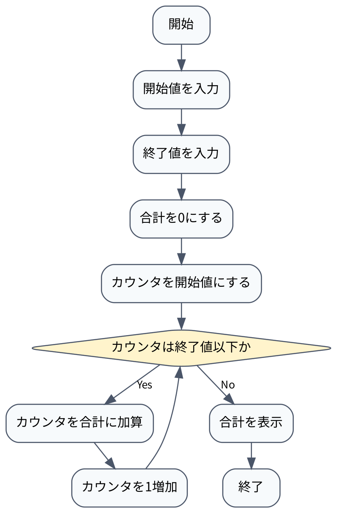

## 4. 課題2

### 4.1 課題内容

曜日を表す配列を用意し、標準入力から曜日の番号を複数受け取る。入力された番号を小さい順に並べ替え、番号に対応する曜日を表示する。入力はEOFまで受け取る。

### 4.2 実装

ファイル名: `2.pl`

```perl
#!/usr/bin/perl
use strict;
use warnings;

my @week = (
    "Sunday", "Monday", "Tuesday", "Wednesday",
    "Thursday", "Friday", "Saturday"
);

print "index>\n";

my @l = <STDIN>;
chomp(@l);

@l = sort { $a <=> $b } @l;

foreach my $i (@l) {
    print "week[$i]: $week[$i]\n";
}
```

`@week`は0番目をSunday、1番目をMondayとする曜日の配列である。`<STDIN>`をリストコンテキストで使用することで、EOFまでの入力を一度に`@l`へ読み込む。`sort { $a <=> $b }`は文字列順ではなく数値順で並べ替えるため、入力順が不規則でも番号の昇順で表示できる。

### 4.3 実行結果

```text
$ printf "6\n3\n5\n2\n" | perl 2.pl
index>
week[2]: Tuesday
week[3]: Wednesday
week[5]: Friday
week[6]: Saturday
```

入力した順番は6、3、5、2であるが、出力は2、3、5、6の順番になっている。このことから、数値として正しくソートされていることを確認した。

### 4.4 フローチャート

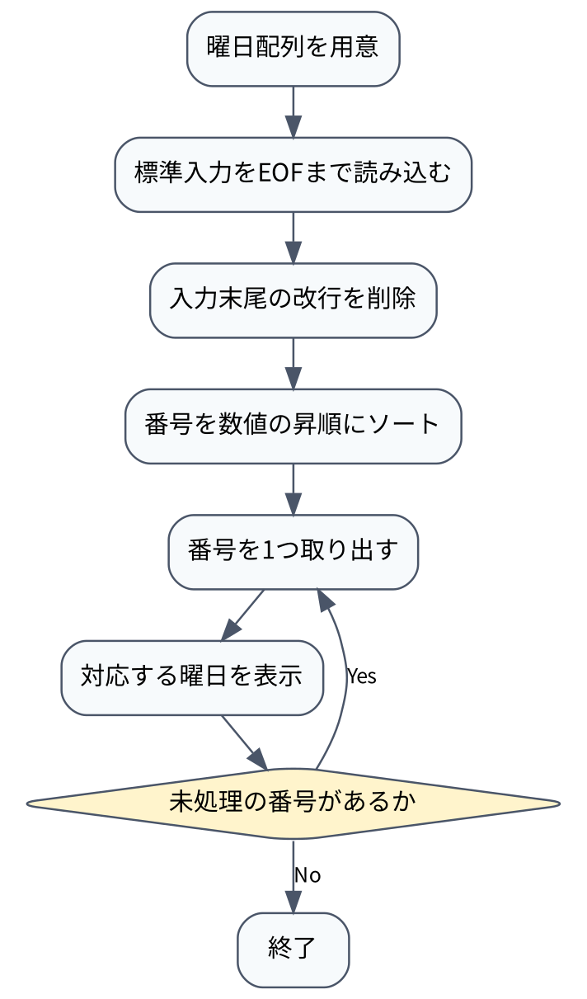

## 5. 課題3

### 5.1 課題内容

整数のリストを引数として受け取るサブルーチンを作成する。リストの平均値を求め、平均値より大きい要素だけを返す。

### 5.2 実装

ファイル名: `3.pl`

```perl
#!/usr/bin/perl
use strict;
use warnings;

sub above_average {
    my @l = @_;
    my $sum = 0;

    foreach my $x (@l) {
        $sum += $x;
    }

    my $avg = $sum / scalar @l;
    print "avg = $avg\n";

    my @result;

    foreach my $x (@l) {
        if ($x > $avg) {
            push @result, $x;
        }
    }

    return @result;
}

my @result = &above_average(10, 80, 32, 58, 13, 3);

print "result: @result\n";
```

`@_`にはサブルーチンへ渡された引数が入るため、`my @l = @_`で引数をローカルな配列にコピーする。最初の`foreach`で合計を求め、要素数で割って平均値を計算する。次の`foreach`では、各要素について平均値との大小を比較し、平均値より大きい要素だけを`@result`へ`push`する。

### 5.3 実行結果

```text
$ perl 3.pl
avg = 32.6666666666667
result: 80 58
```

入力リストの合計は196、要素数は6であるため、平均値は約32.6667となる。この値より大きい80と58だけが結果に含まれた。

### 5.4 フローチャート

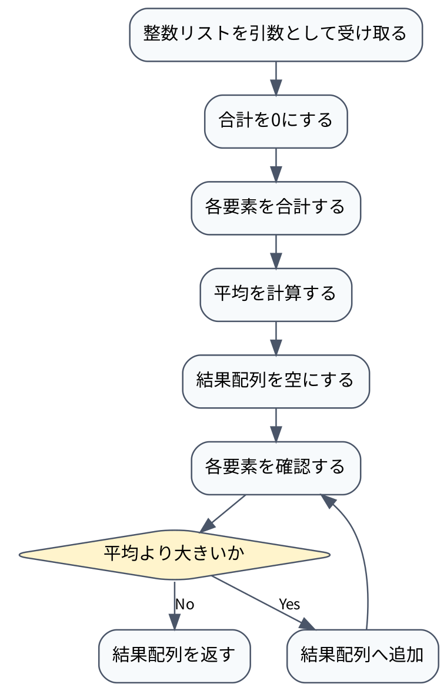

## 6. 課題4

### 6.1 課題内容

Perlの特殊ハッシュ`%ENV`に保存されている環境変数のキーと値をすべて表示する。ただし、キーを昇順に並べて表示する。

### 6.2 実装

ファイル名: `4.pl`

```perl
#!/usr/bin/perl
use strict;
use warnings;

foreach my $key (sort keys %ENV) {
    print "$key = $ENV{$key}\n";
}
```

`keys %ENV`で環境変数のキー一覧を取得し、`sort`でキーを文字列の昇順に並べ替える。その後、`foreach`でキーを1つずつ取り出し、`$ENV{$key}`で対応する値を参照して表示する。環境変数の内容は実行環境によって異なるが、キーの並び順は一定になる。

### 6.3 実行結果

```text
$ perl 4.pl
COLCON_PREFIX_PATH = /home/kazu/robocon/install
COLORTERM = truecolor
DBUS_SESSION_BUS_ADDRESS = unix:path=/run/user/1000/bus
DEBUGINFOD_URLS = https://debuginfod.ubuntu.com 
DESKTOP_SESSION = ubuntu
DISPLAY = :0
GDMSESSION = ubuntu
GNOME_DESKTOP_SESSION_ID = this-is-deprecated
GNOME_SETUP_DISPLAY = :1
GNOME_SHELL_SESSION_MODE = ubuntu
LANG = ja_JP.UTF-8
LANGUAGE = ja:en
LC_ADDRESS = ja_JP.UTF-8
LC_ALL = en_US.UTF-8
LC_IDENTIFICATION = ja_JP.UTF-8
LC_MEASUREMENT = ja_JP.UTF-8
LC_MONETARY = ja_JP.UTF-8
LC_NAME = ja_JP.UTF-8
LC_NUMERIC = ja_JP.UTF-8
LC_PAPER = ja_JP.UTF-8
LC_TELEPHONE = ja_JP.UTF-8
LC_TIME = ja_JP.UTF-8
LD_LIBRARY_PATH = /home/kazu/robocon/install/.....
USER = kazu
USERNAME = kazu
QT_ACCESSIBILITY = 1
QT_IM_MODULE = ibus
RCUTILS_COLORIZED_OUTPUT = 1
RCUTILS_CONSOLE_OUTPUT_FORMAT = [{severity} {time}] [{name}]: {message} ({function_name}() at {line_number})
ROS_AUTOMATIC_DISCOVERY_RANGE = SUBNET
ROS_DISTRO = jazzy
ROS_PYTHON_VERSION = 3
ROS_VERSION = 2
.....
```

実行環境に設定されたすべての環境変数が出力された。先頭部分では`AMENT_PREFIX_PATH`、`BROWSER_USE_ACCESS_VERIFYING_IDENTITY`、`CHROME_DESKTOP`の順になっており、キーの昇順で処理されていることを確認した。

### 6.4 フローチャート

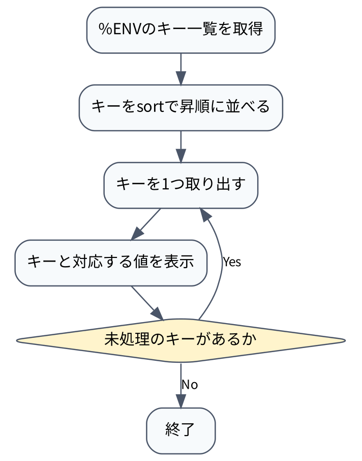

## 7. 課題5

### 7.1 課題内容

0または1が1回以上連続した後に、最後に5が続く文字列だけを受け付ける。例えば、`0005`や`0105`は受け付け、`a115`や`b5`は受け付けない。

### 7.2 実装

ファイル名: `5.pl`

```perl
#!/usr/bin/perl
use strict;
use warnings;

print "input> ";
my $input = <STDIN>;
chomp($input);

if ($input =~ /^[01]+5$/) {
    print "accepted\n";
} else {
    print "not accepted\n";
}
```

正規表現`^[01]+5$`は、文字列の先頭を表す`^`、0または1の1回以上の繰り返しを表す`[01]+`、最後の5、文字列の末尾を表す`$`から構成される。そのため、文字列全体が条件に一致する場合だけ`accepted`を表示する。`chomp`は入力末尾の改行を取り除くために使用している。

### 7.3 実行結果

```text
$ printf "0005\n" | perl 5.pl
input> accepted

$ printf "0105\n" | perl 5.pl
input> accepted

$ printf "a115\n" | perl 5.pl
input> not accepted

$ printf "b5\n" | perl 5.pl
input> not accepted
```

指定された受理例と拒否例の両方で、正規表現が意図した判定を行うことを確認した。

### 7.4 フローチャート

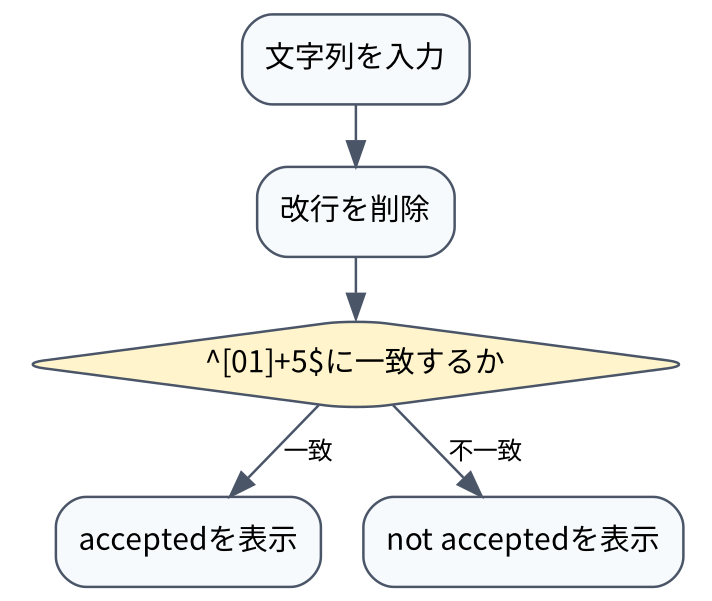

## 8. 課題6

### 8.1 課題内容

CGIプログラムが呼び出された回数をファイルに保存し、ページを表示するたびにカウンタを1増加させる。保存した値は次回のアクセスでも利用する。

### 8.2 実装

ファイル名: `6.cgi`

```perl
#!/usr/bin/perl
use strict;
use warnings;

my $file = "6.txt";
my $count = 0;

if (open(my $fh, "<", $file)) {
    $count = <$fh>;
    close($fh);
}

$count++;

open(my $fh, ">", $file) or die "Cannot open file: $!";
print $fh $count;
close($fh);

print "Content-type: text/html\n\n";
print "<html>\n";
print "<head><title>Access Counter</title></head>\n";
print "<body>\n";
print "<h1>Access Counter</h1>\n";
print "<p>Access count: $count</p>\n";
print "</body>\n";
print "</html>\n";
```

最初に`6.txt`を読み込み、ファイルが存在しない場合はカウンタを0として扱う。次に`$count++`で値を1増加させ、`6.txt`を上書きして新しい値を保存する。最後に、CGIのレスポンスヘッダとして`Content-type: text/html`を出力し、HTML本文に現在のアクセス回数を埋め込む。

### 8.3 フローチャート

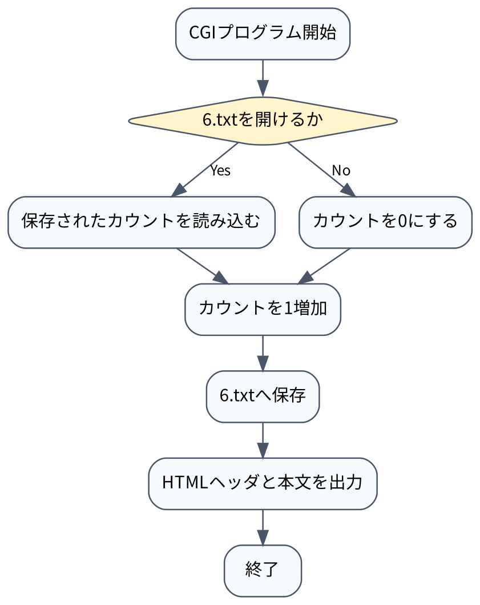

### 8.4 実行結果

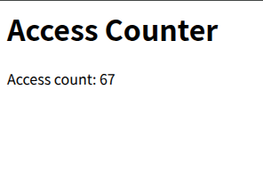

## 9. 課題7

### 9.1 課題内容

テキスト入力欄と送信ボタンを持つフォームを作成する。送信ボタンが押された場合、入力された文字列を画面に表示する。

### 9.2 実装

ファイル名: `7.cgi`

```perl
#!/usr/bin/perl
use strict;
use warnings;
use CGI qw(:standard);

my $body = "";

if (param("send") eq "送信") {
    my $input = param("text");
    $body = escapeHTML($input) . " が入力されました。";
}

print header(-type => "text/html", -charset => "UTF-8");

print <<HTML;
<!DOCTYPE html>
<html lang="ja">
<head>
    <meta charset="UTF-8">
    <title>課題7</title>
</head>
<body>
    <form method="POST">
        <input type="text" name="text">
        <input type="submit" name="send" value="送信">
    </form>
    <p>$body</p>
</body>
</html>
HTML
```

`param("text")`で入力欄の値を取得し、`param("send")`で送信ボタンが押されたかを判定する。入力文字列をそのままHTMLへ埋め込むと、入力内容によってはHTMLタグとして解釈される可能性がある。そのため、`escapeHTML`を使用してHTML上で特別な意味を持つ文字をエスケープしてから表示している。

### 9.3 実行結果

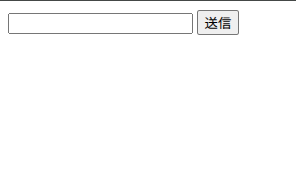

\newpage

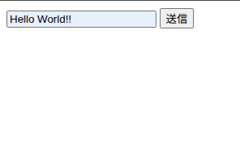

\newpage

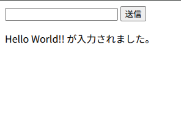

### 9.4 フローチャート

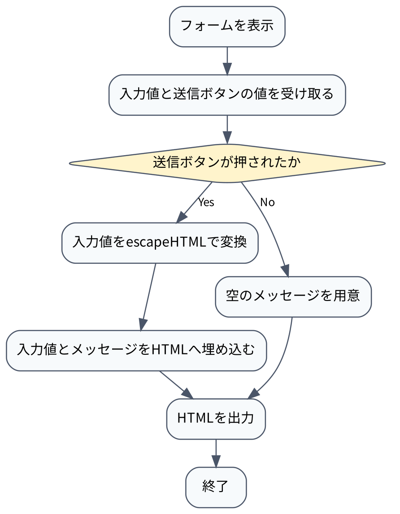

## 10. 課題8

### 10.1 課題内容

入力フォームから投稿された文字列をファイルへ保存し、保存済みの投稿を掲示板として表示する。新しい投稿はファイルの先頭へ追加し、投稿の新しい順に表示する。

### 10.2 実装

ファイル名: `8.cgi`

```perl
#!/usr/bin/perl
use strict;
use warnings;
use utf8;
use CGI qw(:standard -utf8);
use FindBin;

my $file = "$FindBin::Bin/8.txt";
my $body = "";

if (defined param("send") && param("send") eq "送信") {
    my $input = param("text");

    if (defined $input && $input ne "") {
        my @lines = ();

        if (open(my $fh, "<:encoding(UTF-8)", $file)) {
            @lines = <$fh>;
            close($fh);
        }

        open(my $fh, ">:encoding(UTF-8)", $file)
            or die "Cannot write $file: $!";

        print $fh "$input\n";
        print $fh @lines;
        close($fh);
    }
}

if (open(my $fh, "<:encoding(UTF-8)", $file)) {
    while (my $line = <$fh>) {
        chomp($line);
        $body .= "<p>" . escapeHTML($line) . "</p>\n";
    }
    close($fh);
}

binmode(STDOUT, ":encoding(UTF-8)");

print header(-type => "text/html", -charset => "UTF-8");

print <<HTML;
<!DOCTYPE html>
<html lang="ja">
<head>
    <meta charset="UTF-8">
    <title>掲示板</title>
</head>
<body>
    <h1>掲示板</h1>

    <form method="POST" accept-charset="UTF-8">
        <input type="text" name="text">
        <input type="submit" name="send" value="送信">
    </form>

    <h2>投稿一覧</h2>
    $body
</body>
</html>
HTML
```

ファイル名は`FindBin::Bin`を使ってCGIファイルと同じディレクトリにある`8.txt`を指定している。送信ボタンが押され、入力文字列が空でない場合、まず既存の行を`@lines`へ読み込む。その後、ファイルを上書きモードで開き、新しい入力を先に書き込み、続けて既存の行を書き込む。これにより、新しい投稿が先頭に追加される。

表示時には`8.txt`を1行ずつ読み込み、それぞれを`<p>`要素で囲む。投稿内容は`escapeHTML`でエスケープしてからHTMLへ埋め込むため、投稿に`<`や`>`が含まれていてもHTMLタグとして実行されない。`UTF-8`を指定しているため、日本語の入出力にも対応している。

### 10.3 フローチャート

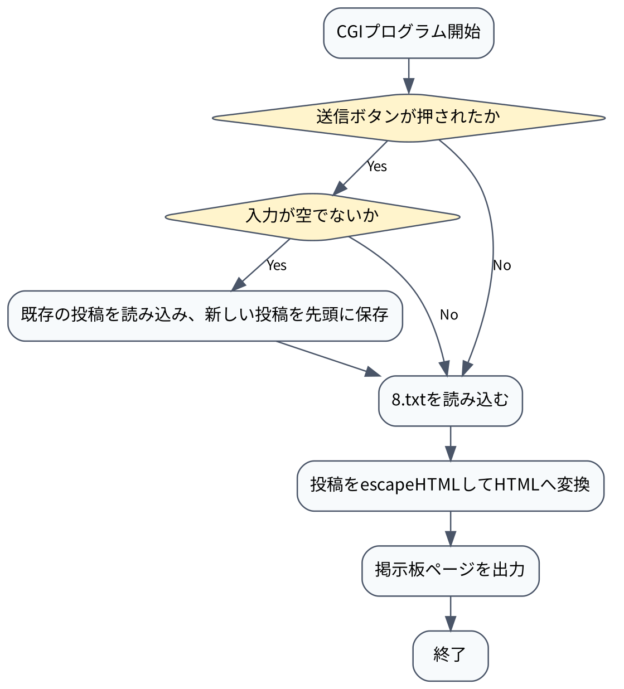

### 10.4 実行結果

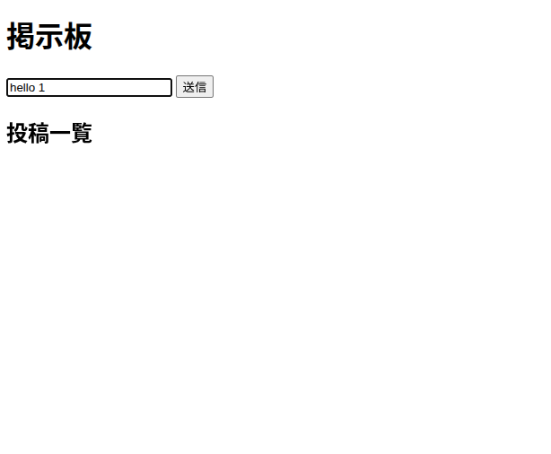

\newpage

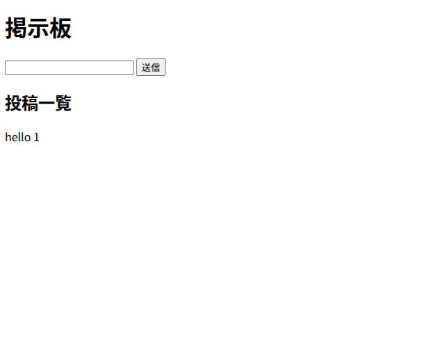

\newpage

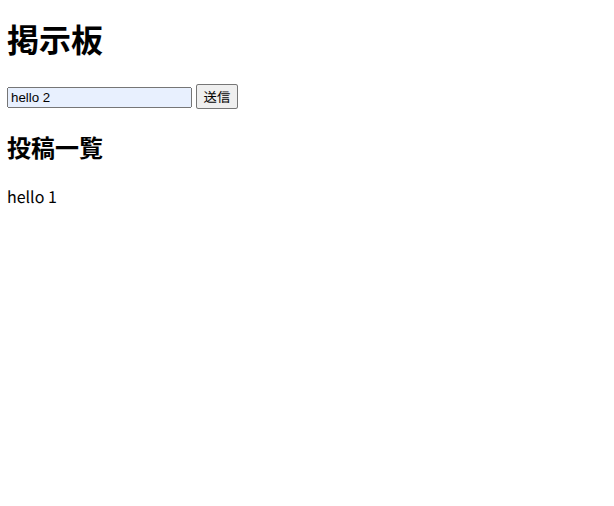

\newpage

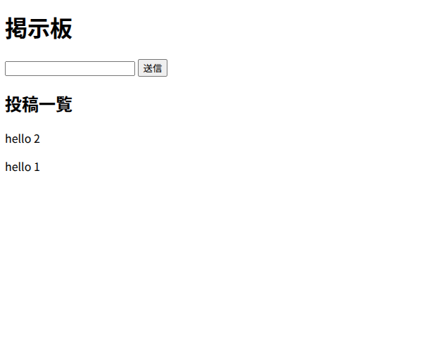

## 11. 他のスクリプト言語

スクリプト言語は、一般にコンパイル済みの実行ファイルを作ることを前提とせず、インタプリタなどを使ってソースコードを実行する言語である。処理系の起動が必要になる一方で、短いプログラムを素早く作成して試せること、文字列やファイルを扱うライブラリが充実していることが特徴である。

### Python

Pythonは、インデントによってブロックを表現するため、プログラムの構造が読みやすい。標準ライブラリが広く、Webアプリケーション、データ処理、機械学習、教育用プログラム、自動化スクリプトなどで利用されている。今回使用した`server.py`もPythonで記述し、CGIHTTPRequestHandlerを用いてCGIプログラムを実行した。

### Ruby

Rubyは、文字列や配列などのオブジェクト指向的な操作を簡潔に記述できる。WebアプリケーションフレームワークのRuby on Railsで広く利用されているほか、テキスト処理や自動化にも使われる。Perlと同じく、少ない記述量で文字列やファイルを扱える点が特徴である。

### JavaScript

JavaScriptはWebブラウザで動作する代表的なスクリプト言語である。ボタン操作や入力内容の検証など、ページを表示した後の動的な処理に利用される。現在はNode.jsによってサーバ側でも動作し、Webサーバ、API、コマンドラインツールの作成にも利用されている。

### PHP

PHPは、Webサーバ上でHTMLを生成するために広く利用されてきたスクリプト言語である。フォーム処理、データベース接続、セッション管理など、Webアプリケーションに必要な機能をまとめて実装しやすい。今回の課題で作成したCGIと同様に、入力を受け取り、その結果からHTMLを生成する用途に適している。

## 12. まとめ・感想

課題1〜5では、Perlの標準入力、配列、ハッシュ、サブルーチン、正規表現を使った処理を実装した。特に課題2では、入力をEOFまで受け取る方法と、数値比較を指定した`sort`の使い方を確認できた。課題3では、サブルーチンの引数が`@_`に渡され、戻り値として配列を返せることを確認した。課題5では、正規表現の`^`、`$`、`+`を組み合わせることで、入力文字列全体に条件を適用できた。

課題6〜8では、端末上で動くスクリプトとは異なり、WebサーバがCGIを起動し、CGIがHTTPレスポンスを生成する流れを確認した。課題6ではファイルを使って状態を保持し、課題7ではフォームの入力値を取得して表示し、課題8ではファイルへ投稿を保存して掲示板として表示した。課題7と課題8で`escapeHTML`を利用したことで、入力値をHTMLへ表示する場合には、単に文字列を連結するのではなく、HTMLとして安全に扱える形へ変換する必要があることも分かった。

また、課題8では新しい投稿をファイルの先頭へ書き込むことで、新しい順に表示する処理を実現した。ファイルの読み込み、先頭への追加、HTMLへの変換という複数の処理を順番に行う必要があり、データをどの段階でどの形式に変換するかを考えることが重要だと感じた。

すべてのPerlプログラムについて構文チェックを行い、課題1〜5は端末で、課題6〜8はCGIとして動作を確認した。実装後に期待する入力と出力を具体的に決めてテストすることで、プログラムが仕様を満たしているかを確認できた。今後は、ファイルが存在しない場合、入力が空の場合、特殊文字を入力した場合など、通常例だけでなく境界条件や異常入力もさらに調べたい。
